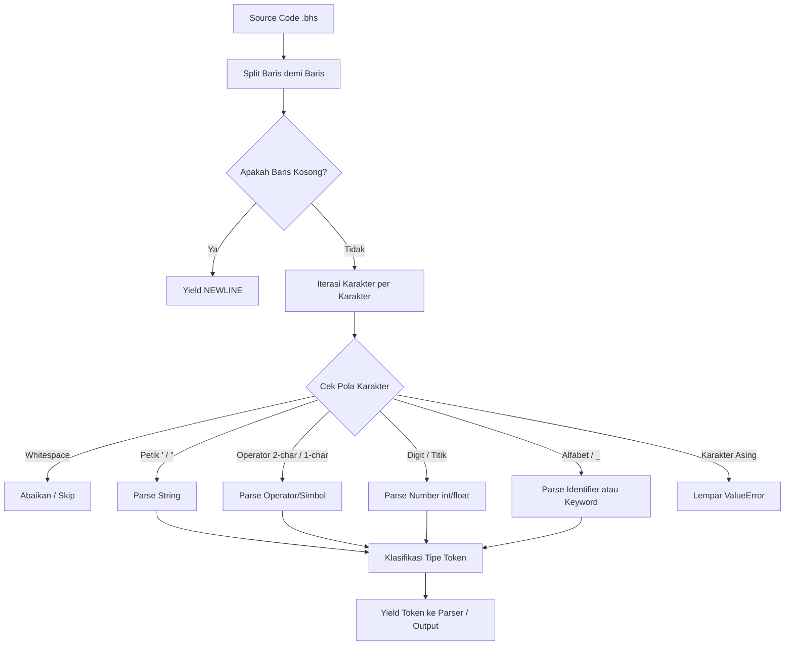

# 🚀 BahasaKu - Proyek Perancangan Kompiler (Teknik Kompilasi)

[](https://www.python.org/)
[](#)
[](#)

**BahasaKu** adalah bahasa pemrograman edukatif berbasis bahasa Indonesia yang dirancang untuk mempelajari konsep dasar mata kuliah **Teknik Kompilasi** (*Compiler Design*). Proyek ini saat ini berada pada **Tahap 1: Analisis Leksikal (*Lexical Analysis / Tokenizer*)**.

Lexer bertugas membaca kode sumber karakter demi karakter, membuang spasi kosong (*whitespace*), dan mengelompokkannya menjadi serangkaian unit bermakna yang disebut **Token**.

---

## 📋 Daftar Isi

- [Fitur Utama](#-fitur-utama)
- [Struktur Repositori](#-struktur-repositori)
- [Spesifikasi BahasaKu](#-spesifikasi-bahasaku)
  - [1. Kata Kunci (*Keywords*)](#1-kata-kunci-keywords)
  - [2. Operator](#2-operator)
  - [3. Simbol / Delimiter](#3-simbol--delimiter)
  - [4. Literal (Angka & String)](#4-literal-angka--string)
  - [5. Pengidentifikasi (*Identifier*)](#5-pengidentifikasi-identifier)
- [Arsitektur & Komponen Lexer](#-arsitektur--komponen-lexer)
  - [Alur Kerja (*Lexical Pipeline*)](#alur-kerja-lexical-pipeline)
  - [Metode Utama pada Class `Lexer`](#metode-utama-pada-class-lexer)
- [Penanganan Kesalahan (*Error Handling*)](#-penanganan-kesalahan-error-handling)
- [Instalasi & Persyaratan](#-instalasi--persyaratan)
- [Cara Menjalankan](#-cara-menjalankan)
  - [Eksekusi Contoh Pengujian](#eksekusi-contoh-pengujian)
  - [Contoh Kode Sumber (`.bhs`)](#contoh-kode-sumber-bhs)
  - [Contoh Output Token](#contoh-output-token)
- [Rencana Pengembangan (Roadmap)](#-rencana-pengembangan-roadmap)
- [Lisensi](#-lisensi)

---

## ✨ Fitur Utama

- **Pendekatan Generator Efisien**: Token dihasilkan secara bertahap (*lazy generation* via `yield`), menghemat memori untuk berkas kode besar.
- **Dukungan Bilingual pada Keyword**: Mendukung kata kunci berbahasa Indonesia (`jika`, `selain`, `cetak`) serta padanan bahasa Inggris (`if`, `else`, dll).
- **Penanganan Angka Bulat dan Desimal**: Mampu mengenali bilangan bulat (*integer*) maupun desimal (*float*).
- **Validasi String Aman**: Mendukung tanda kutip tunggal (`'...'`) dan ganda (`"..."`) dengan validasi penutup tanda kutip.
- **Deteksi Kesalahan Informatif**: Menampilkan nomor baris dan deskripsi galat secara presisi saat terjadi *lexical error*.
- **Mendukung Lookahead & Backtracking**: Tersedia metode `next_token()` dan `return_token()` untuk kemudahan integrasi dengan Parser (*Tahap 2*).

---

## 📁 Struktur Repositori

```text
Teknik Kompilasi 1/
│
├── bahasaku.py       # Program utama (CLI runner & antarmuka eksekusi)
├── bhs_lexer.py      # Modul implementasi Lexer / Tokenizer
├── uji_lexer.bhs     # Berkas contoh kode BahasaKu untuk pengujian
└── README.md         # Dokumentasi lengkap proyek
```

### Rincian Berkas:
1. **`bahasaku.py`**:
   - Berkas *entry-point*.
   - Menerima argumen path file sumber `.bhs`.
   - Menginisialisasi `Lexer` dan menampilkan daftar token yang berhasil diurai ke layar konsol.
2. **`bhs_lexer.py`**:
   - Berisi kelas utama `Lexer`.
   - Mengimplementasikan logika pengenalan token berbasis finite state machine / aturan pemindaian string.
3. **`uji_lexer.bhs`**:
   - Program contoh berisi inisialisasi variabel, operasi aritmatika/relasional, percabangan (`jika` / `selain`), dan pemanggilan fungsi `cetak`.

---

## 📖 Spesifikasi BahasaKu

### 1. Kata Kunci (*Keywords*)

BahasaKu mengenali kata kunci berikut:

| Kategori | Keyword Bahasa Indonesia | Keyword Bahasa Inggris (Alternatif) |
|---|---|---|
| **I/O** | `cetak` | - |
| **Kondisional** | `jika`, `ataujika`, `selain`, `lainnya` | `if`, `else` |
| **Perulangan** | `selama`, `untuk` | `while`, `for` |
| **Blok Kontrol** | `akhir` | - |

Format token: `('KEYWORD', '<nama_keyword>')`

### 2. Operator

Dua karakter dicek terlebih dahulu sebelum satu karakter untuk memastikan operator multi-karakter (seperti `>=` atau `==`) tidak terpecah.

| Jenis Operator | Simbol | Token Output |
|---|---|---|
| Penugasan (*Assignment*) | `=` | `('OPERATOR', '=')` |
| Aritmatika | `+`, `-`, `*`, `/` | `('OPERATOR', '+')`, dst. |
| Perbandingan Relasional | `==`, `!=`, `<`, `>`, `<=`, `>=` | `('OPERATOR', '==')`, dst. |

### 3. Simbol / Delimiter

| Simbol | Keterangan | Token Output |
|---|---|---|
| `(` | Kurung buka | `('SYMBOL', '(')` |
| `)` | Kurung tutup | `('SYMBOL', ')')` |
| `:` | Titik dua (penanda awal blok) | `('SYMBOL', ':')` |

### 4. Literal (Angka & String)

- **Integer**: Deretan angka tanpa titik desimal. Dikonversi ke tipe data `int`.
  - Contoh: `85`, `0`, `1234` $\rightarrow$ `('NUMBER', 85)`
- **Float**: Deretan angka yang memiliki tepat satu titik desimal. Dikonversi ke tipe data `float`.
  - Contoh: `3.14`, `0.5` $\rightarrow$ `('NUMBER', 3.14)`
- **String**: Teks yang diapit oleh petik ganda (`"..."`) atau petik tunggal (`'...'`).
  - Contoh: `"Budi"`, `'Lulus'` $\rightarrow$ `('STRING', 'Budi')`

### 5. Pengidentifikasi (*Identifier*)

- Aturan penamaan: Diawali oleh huruf (`a-z`, `A-Z`) atau garis bawah (`_`), diikuti oleh huruf, angka, atau garis bawah (`_`).
- Tidak boleh sama dengan *Keywords*.
- Contoh: `nilai`, `pi`, `nama_lengkap`, `_counter` $\rightarrow$ `('IDENTIFIER', 'nilai')`

### 6. Baris Baru (*Newline*)

- Setiap baris kosong atau akhir pemindaian satu baris instruksi menghasilkan token penanda pemisah baris:
  - Token Output: `('NEWLINE',)`

---

## ⚙️ Arsitektur & Komponen Lexer

### Alur Kerja (*Lexical Pipeline*)



### Metode Utama pada Class `Lexer`

| Metode | Deskripsi |
|---|---|
| `__init__(self, code)` | Menginisialisasi lexer dengan string kode program dan menyiapkan *generator* `token_feed`. |
| `tokens(self)` | Generator utama yang membaca baris demi baris, memindai karakter, dan memancarkan (*yield*) tuple token. |
| `next_token(self)` | Mengambil satu token berikutnya dari antrean stream. Jika ada token yang dikembalikan sebelumnya (*backtracked*), token tersebut akan diprioritaskan. |
| `return_token(self, tok)` | Mengembalikan sebuah token ke penyangga (*buffer* lookahead). Sangat krusial saat parser butuh melakukan teknik *lookahead* 1 token. |
| `reset_tokenizer(self)` | Mengatur ulang pembacaan dari baris pertama. |
| `raise_error(self, msg)` | Melempar exception `ValueError` terformat lengkap dengan nomor baris terjadinya kesalahan. |

---

## ⚠️ Penanganan Kesalahan (*Error Handling*)

Lexer dilengkapi penanganan galat (*lexical error*) yang informatif dan terpusat:

1. **String Tidak Ditutup**:
   ```bhs
   nama = "Budi
   ```
   **Pesan Galat**: `Lexical Error: Baris 1: String tidak ditutup`

2. **Format Angka Tidak Sah (Lebih dari 1 titik desimal)**:
   ```bhs
   versi = 1.2.3
   ```
   **Pesan Galat**: `Lexical Error: Baris 1: Format angka tidak sah`

3. **Karakter / Simbol Tidak Sah**:
   ```bhs
   email = user@domain.com
   ```
   **Pesan Galat**: `Lexical Error: Baris 1: Token tidak sah: @`

---

## 📦 Instalasi & Persyaratan

### Persyaratan Lingkungan:
- **Python 3.8** atau versi lebih baru.
- Tidak memerlukan pustaka pihak ketiga (*zero external dependencies* / murni pustaka standar Python).

### Kloning & Persiapan:
```bash
# Pastikan terminal berada pada direktori proyek
cd "Teknik Kompilasi 1"

# Pastikan Python terinstal
python --version
```

---

## 🚀 Cara Menjalankan

### Eksekusi Contoh Pengujian

Gunakan perintah berikut untuk memindai berkas `uji_lexer.bhs`:

```bash
python bahasaku.py uji_lexer.bhs
```

### Contoh Kode Sumber (`uji_lexer.bhs`)

```python
nilai = 85
pi = 3.14
nama = "Budi"

jika nilai >= 80:
    cetak('Lulus')
selain:
    cetak("Gagal")
akhir
```

### Contoh Output Token

Hasil keluaran di terminal saat proses leksikal berjalan:

```text
============================================================
TAHAP 1: ANALISIS LEKSIKAL
============================================================
('IDENTIFIER', 'nilai')
('OPERATOR', '=')
('NUMBER', 85)
('NEWLINE',)
('IDENTIFIER', 'pi')
('OPERATOR', '=')
('NUMBER', 3.14)
('NEWLINE',)
('IDENTIFIER', 'nama')
('OPERATOR', '=')
('STRING', 'Budi')
('NEWLINE',)
('NEWLINE',)
('KEYWORD', 'jika')
('IDENTIFIER', 'nilai')
('OPERATOR', '>=')
('NUMBER', 80)
('SYMBOL', ':')
('NEWLINE',)
('KEYWORD', 'cetak')
('SYMBOL', '(')
('STRING', 'Lulus')
('SYMBOL', ')')
('NEWLINE',)
('KEYWORD', 'selain')
('SYMBOL', ':')
('NEWLINE',)
('KEYWORD', 'cetak')
('SYMBOL', '(')
('STRING', 'Gagal')
('SYMBOL', ')')
('NEWLINE',)
('KEYWORD', 'akhir')
('NEWLINE',)
```

---

## 🗺️ Rencana Pengembangan (Roadmap)

Kompiler **BahasaKu** dirancang untuk diselesaikan dalam tahapan berjenjang:

- [x] **Tahap 1: Analisis Leksikal (*Lexer*)**
  - Pemindaian karakter ke token stream.
  - Penanganan keyword, identifier, operator, simbol, string, dan number.
  - Pelacakan baris dan pelaporan galat leksikal.
- [ ] **Tahap 2: Analisis Sintaksis (*Parser*)**
  - Implementasi *Recursive Descent Parser* atau *Shift-Reduce*.
  - Pembangunan Struktur Pohon Sintaksis Abstrak (*Abstract Syntax Tree / AST*).
  - Pengecekan tata bahasa (*grammar*) untuk pernyataan variabel, percabangan, dan perulangan.
- [ ] **Tahap 3: Analisis Semantik (*Semantic Analyzer*)**
  - Pengecekan tabel simbol (*Symbol Table*).
  - Validasi tipe data (*Type Checking*) dan deklarasi variabel sebelum digunakan.
- [ ] **Tahap 4: Eksekusi Kode / Generator Kode**
  - *Tree-walking Interpreter* atau kompilasi ke *Intermediate Representation* / Python Bytecode.
  - Eksekusi hasil komputasi dan output I/O secara langsung.

---

## 📄 Lisensi

Proyek ini dibuat untuk keperluan pembelajaran akademik mata kuliah **Teknik Kompilasi**. Bebas digunakan dan dimodifikasi untuk tujuan edukasi.
